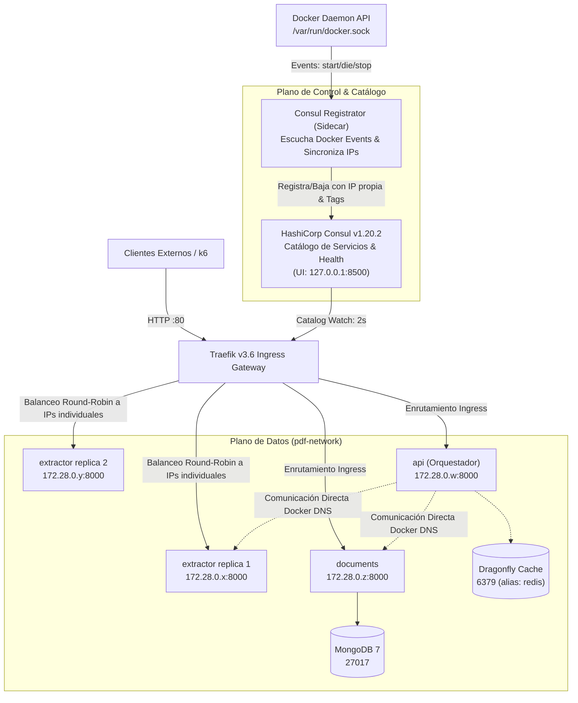

# Contrato de Infraestructura, Redes, Resiliencia y Consul (`CONTRACTS.md`)
**Proyecto:** `pdf-extractext`  
**Cátedra:** Desarrollo de Software — UTN Facultad Regional San Rafael  
**Repositorio Central:** `pdf-infrastructure`  

Este documento define el **contrato oficial de infraestructura, redes, catálogo de servicios con HashiCorp Consul, patrones de resiliencia y ciclo de vida** para todos los microservicios del ecosistema. Todos los integrantes del equipo deben adherirse estrictamente a estas especificaciones en sus respectivos repositorios (`pdf-extractor-service`, `pdf-document-service` y `pdf-api-service`).

---

## 1. Topología de Red y Arquitectura de Descubrimiento

Todos los contenedores se integran a través de una red puente externa compartida de Docker denominada **`pdf-network`**.

El descubrimiento y balanceo dinámico de microservicios se delega a **HashiCorp Consul** y su integración nativa con **Traefik v3.6 (Consul Catalog Provider)**.



### Tabla Oficial de Enrutamiento, Direcciones y Descubrimiento

| Servicio | Repositorio | DNS Interno Docker | Puerto Interno | URL Interna (Inter-servicio) | Hostname Ingress Traefik (HTTP 80) | Proveedor en Traefik |
| :--- | :--- | :--- | :--- | :--- | :--- | :--- |
| **Traefik Dashboard** | `pdf-infrastructure` | `traefik` | `8080` | `http://traefik:8080` | `http://traefik.universidad.localhost` (o `127.0.0.1:8080`) | `docker` (`api@internal`) |
| **Consul UI / API** | `pdf-infrastructure` | `consul` | `8500` | `http://consul:8500` | `http://127.0.0.1:8500` (restringido a loopback) | N/A (Plano de control) |
| **Extractor Service** | `pdf-extractor-service` | `extractor` | `8000` | `http://extractor:8000` | `http://extractor.universidad.localhost` | `consulCatalog` (`extractor`) |
| **Document Service** | `pdf-document-service` | `documents` | `8000` | `http://documents:8000` | `http://documents.universidad.localhost` | `consulCatalog` (`documents`) |
| **API Orchestrator** | `pdf-api-service` | `api` | `8000` | `http://api:8000` | `http://api.universidad.localhost` | `consulCatalog` (`api`) |
| **MongoDB 7** (Datos) | `pdf-document-service` | `mongodb` | `27017` | `mongodb://mongodb:27017` | *No expuesto públicamente* | N/A |
| **Dragonfly** (Caché) | `pdf-infrastructure` | `dragonfly` (alias `redis`) | `6379` | `redis://dragonfly:6379/0` (o `redis://redis:6379/0`) | *No expuesto públicamente* | N/A |

---

## 2. Separación de Responsabilidades de Proveedores en Traefik

Para evitar que Traefik cree routers duplicados o colisiones entre Docker y Consul:
1. **Proveedor Docker:** Exclusivo para la infraestructura interna de Traefik (su Dashboard en `traefik.universidad.localhost` vía `api@internal`).
2. **Proveedor Consul Catalog (`consulCatalog`):** **Único dueño** del descubrimiento, routers, balanceo y backends de los microservicios (`extractor`, `documents` y `api`). Los contenedores tienen `traefik.enable=false` en sus labels de Docker para no ser publicados por el proveedor Docker.
3. **Proveedor de Archivo Dinámico (`file`):** Contiene la definición centralizada de los middlewares de resiliencia (`traefik/dynamic/middlewares.yml`). Los tags de Consul hacen referencia a ellos mediante el sufijo `@file`.

---

## 3. Registro Dinámico de Instancias en Consul

El componente **`consul-registrator`** sincroniza en tiempo real los contenedores de Docker en `pdf-network` con el catálogo de Consul:

### Atributos Registrados por Instancia:
- **`Name`:** Nombre lógico del servicio (`extractor`, `documents`, `api`).
- **`ID`:** Identificador único compuesto (`<service_name>-<container_id_short>`), ej. `extractor-a1b2c3d4e5f6`.
- **`Address`:** Dirección IP individual del contenedor asignada dentro de `pdf-network` (ej. `172.28.0.8`), **nunca** `localhost` ni nombres genéricos.
- **`Port`:** `8000`.
- **`Check` (Health Check HTTP individual):**
  ```json
  {
    "HTTP": "http://<IP_CONTENEDOR>:8000/health",
    "Interval": "3s",
    "Timeout": "2s",
    "DeregisterCriticalServiceAfter": "30s"
  }
  ```
- **`Tags`:** Metadatos para Traefik `consulCatalog`:
  * Enrutamiento de negocio (`Host(...)`, entrypoint `web`, prioridad `10`).
  * Enrutamiento de salud (`Path('/health')`, prioridad `100`, **sin RateLimit**).
  * Middlewares asignados: `rate-limit-extract@file`, `circuit-breaker-extractor@file`, `retry-on-shutdown@file`.

### Ciclo de Vida:
- **Inicio / Escalado:** Cuando el Extractor se escala (ej. `scale extractor=5`), el registrador captura los eventos `start` y registra cada una de las 5 réplicas con su IP propia. Traefik las agrupa bajo el servicio `extractor@consulcatalog` y balancea round-robin entre las 5 IPs.
- **Detención:** Al detenerse una réplica (`docker stop` o escala hacia abajo), el registrador recibe el evento `die`/`stop` y la desregistra inmediatamente en Consul. Si la caída es súbita, el health check de Consul falla a los 3s y Traefik la retira del pool.
- **Reconciliación Periódica:** Cada 10 segundos, un bucle de reconciliación compara los contenedores activos de Docker con los servicios en Consul, saneando instancias huérfanas o registrando réplicas omitidas ante micro-cortes.

---

## 4. Patrones de Resiliencia en Traefik

```
[ Petición Externa ] ──► [ 1. RateLimit ] ──► [ 2. CircuitBreaker ] ──► [ 3. Retry ] ──► [ Instancia Saludable en Consul ]
```

1. **Rate Limiting (`rate-limit-extract@file`):** 10 req/s promedio con ráfaga de 20 (`burst`). Las peticiones en exceso reciben `HTTP 429 Too Many Requests`.
2. **Circuit Breaker (`circuit-breaker-extractor@file`):** Se activa si $\text{NetworkErrorRatio}() > 0.30 \lor \text{ResponseCodeRatio}(500, 600, 0, 600) > 0.25$. Responde `HTTP 503 Service Unavailable` durante 10s para permitir la recuperación del backend.
3. **Retry (`retry-on-shutdown@file`):** 3 intentos con 100ms de intervalo inicial. Reenvía a otra réplica saludable **únicamente ante fallos transitorios de socket**. Si el microservicio devuelve un código HTTP (incluso 5xx), Traefik **no** reintenta, garantizando que operaciones no idempotentes (`POST /extract`) no se dupliquen.
4. **Exclusión de Sondas de Salud:** Los routers de `/health` tienen prioridad 100 y **no** aplican el middleware de RateLimit, impidiendo bloqueos de las sondas de Consul o Docker.

---

## 5. Delimitación de Fronteras: Ingress vs. Llamadas Inter-Servicio

> [!IMPORTANT]
> Traefik y Consul Catalog gestionan el tráfico que ingresa por el Ingress.  
> Las llamadas internas directas entre microservicios (de `api` hacia `http://extractor:8000` y `http://documents:8000`) se resuelven mediante el DNS interno de Docker (`pdf-network`) y **no atraviesan Traefik**.  
> Por ello, los patrones de Retry con backoff y Circuit Breaker para llamadas salientes deben residir en el cliente HTTP del API Orchestrator (`pdf-api-service`).

### Especificación para `pdf-api-service` (Lourdes):
- Implementar en `app/clients/` reintentos con backoff exponencial (100ms, 300ms) hasta 2 veces **únicamente** ante errores de red (`httpx.ConnectError`, `httpx.ConnectTimeout`).
- Implementar Circuit Breaker en el cliente: si se registran 3 fallos consecutivos hacia Extractor o Documents, abrir el circuito por 5s y responder `503 service_unavailable` sin esperar timeouts.

---

## 6. Factor IX: Desechabilidad Verificada

- **Fast Startup:** Contenedores pasan a `healthy` en $< 5\text{s}$, medido de forma aislada en la nueva instancia vía `docker inspect`.
- **Graceful Shutdown:** `init: true` (PID 1 con tini), `stop_grace_period` (30s-35s) y drenado de solicitudes en curso verificado con extracciones reales de PDF (terminación limpia con `ExitCode = 0`).
- **Crash Resilience:** Tolerancia comprobada ante caídas súbitas (`SIGKILL`, código `137`), con retiro automático del catálogo y absorción del tráfico por réplicas sobrevivientes con 0% de errores.
