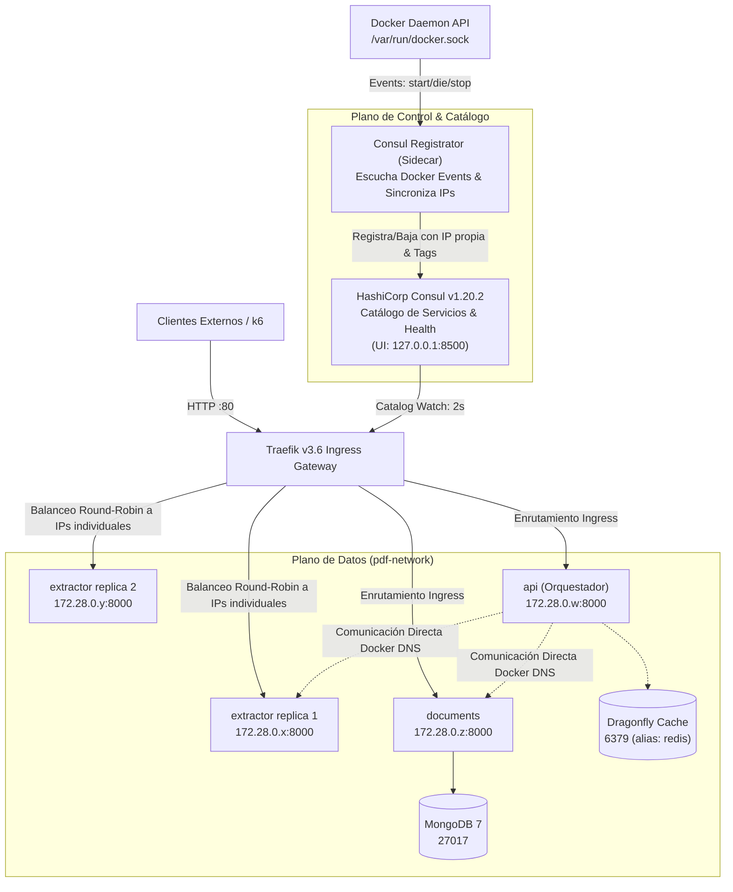
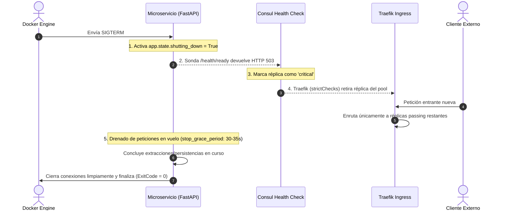

# Contrato de Infraestructura, Redes, Resiliencia y Consul (`CONTRACTS.md`)
**Proyecto:** `pdf-extractext`  
**Cátedra:** Desarrollo de Software — UTN Facultad Regional San Rafael  
**Repositorio Central:** `pdf-infrastructure`  

Este documento define el **contrato oficial de infraestructura, redes, catálogo de servicios con HashiCorp Consul, patrones de resiliencia y ciclo de vida** para todos los microservicios del ecosistema. Todos los integrantes del equipo deben adherirse estrictamente a estas especificaciones en sus respectivos repositorios (`pdf-extractor-service`, `pdf-document-service` y `pdf-api-service`).

---

## 1. Topología de Red y Arquitectura de Descubrimiento

Todos los contenedores se integran a través de una red puente externa compartida de Docker denominada **`pdf-network`**.

El descubrimiento y balanceo dinámico de microservicios se delega a **HashiCorp Consul** y su integración nativa con **Traefik v3.6 (Consul Catalog Provider)**.



### Tabla Oficial de Enrutamiento, Direcciones y Descubrimiento

| Servicio | Repositorio | DNS Interno Docker | Puerto Interno | URL Interna (Inter-servicio) | Hostname Ingress Traefik (HTTP 80) | Proveedor en Traefik |
| :--- | :--- | :--- | :--- | :--- | :--- | :--- |
| **Traefik Dashboard** | `pdf-infrastructure` | `traefik` | `8080` | `http://traefik:8080` | `http://traefik.universidad.localhost` (o `127.0.0.1:8080`) | `docker` (`api@internal`) |
| **Consul UI / API** | `pdf-infrastructure` | `consul` | `8500` | `http://consul:8500` | `http://127.0.0.1:8500` (restringido a loopback) | N/A (Plano de control) |
| **Extractor Service** | `pdf-extractor-service` | `extractor` | `8000` | `http://extractor:8000` | `http://extractor.universidad.localhost` | `consulCatalog` (`extractor`) |
| **Document Service** | `pdf-document-service` | `documents` | `8000` | `http://documents:8000` | `http://documents.universidad.localhost` | `consulCatalog` (`documents`) |
| **API Orchestrator** | `pdf-api-service` | `api` | `8000` | `http://api:8000` | `http://api.universidad.localhost` | `consulCatalog` (`api`) |
| **MongoDB 7** (Datos) | `pdf-document-service` | `mongodb` | `27017` | `mongodb://mongodb:27017` | *No expuesto públicamente* | N/A |
| **Dragonfly** (Caché) | `pdf-infrastructure` | `dragonfly` (alias `redis`) | `6379` | `redis://dragonfly:6379/0` (o `redis://redis:6379/0`) | *No expuesto públicamente* | N/A |

---

## 2. Separación de Responsabilidades de Proveedores en Traefik

Para evitar que Traefik cree routers duplicados o colisiones entre Docker y Consul:
1. **Proveedor Docker:** Exclusivo para la infraestructura interna de Traefik (su Dashboard en `traefik.universidad.localhost` vía `api@internal`).
2. **Proveedor Consul Catalog (`consulCatalog`):** **Único dueño** del descubrimiento, routers, balanceo y backends de los microservicios (`extractor`, `documents` y `api`). Los contenedores tienen `traefik.enable=false` en sus labels de Docker para no ser publicados por el proveedor Docker.
3. **Proveedor de Archivo Dinámico (`file`):** Contiene la definición centralizada de los middlewares de resiliencia (`traefik/dynamic/middlewares.yml`). Los tags de Consul hacen referencia a ellos mediante el sufijo `@file`.

---

## 3. Registro Dinámico de Instancias en Consul

El componente **`consul-registrator`** sincroniza en tiempo real los contenedores de Docker en `pdf-network` con el catálogo de Consul:

### Atributos Registrados por Instancia:
- **`Name`:** Nombre lógico del servicio (`extractor`, `documents`, `api`).
- **`ID`:** Identificador único compuesto (`<service_name>-<container_id_short>`), ej. `extractor-a1b2c3d4e5f6`.
- **`Address`:** Dirección IP individual del contenedor asignada dentro de `pdf-network` (ej. `172.28.0.8`), **nunca** `localhost` ni nombres genéricos.
- **`Port`:** `8000`.
- **`Check` (Health Check HTTP individual de Readiness):**
  ```json
  {
    "HTTP": "http://<IP_CONTENEDOR>:8000/health/ready",
    "Interval": "3s",
    "Timeout": "2s",
    "DeregisterCriticalServiceAfter": "30s"
  }
  ```
  *(En `api`, el endpoint de readiness es `/ready`).*
- **`Tags`:** Metadatos para Traefik `consulCatalog`:
  * Enrutamiento de negocio (`Host(...)`, entrypoint `web`, prioridad `10`).
  * Enrutamiento de salud (`Path('/health')` o `Path('/ready')`, prioridad `100`, **sin RateLimit**).
  * Middlewares asignados: `rate-limit-extract@file`, `circuit-breaker-extractor@file`, `retry-on-shutdown@file`.
- **Filtrado Estricto en Traefik:** Traefik aplica `strictChecks: ["passing"]`, descartando del pool cualquier réplica en estado `warning` o `critical`.

### Ciclo de Vida:
- **Inicio / Escalado:** Cuando el Extractor se escala (ej. `scale extractor=5`), el registrador captura los eventos `start` y registra cada una de las 5 réplicas con su IP propia. Traefik las agrupa bajo el servicio `extractor@consulcatalog` y balancea round-robin entre las 5 IPs.
- **Detención:** Al detenerse una réplica (`docker stop` o escala hacia abajo), el registrador recibe el evento `die`/`stop` y la desregistra inmediatamente en Consul. Si la caída es súbita, el health check de Consul falla a los 3s y Traefik la retira del pool.
- **Reconciliación Periódica:** Cada 10 segundos, un bucle de reconciliación compara los contenedores activos de Docker con los servicios en Consul, saneando instancias huérfanas o registrando réplicas omitidas ante micro-cortes.

---

## 4. Patrones de Resiliencia en Traefik

```
[ Petición Externa ] ──► [ 1. RateLimit ] ──► [ 2. CircuitBreaker ] ──► [ 3. Retry ] ──► [ Instancia Saludable en Consul ]
```

1. **Rate Limiting (`rate-limit-extract@file`):** 10 req/s promedio con ráfaga de 20 (`burst`). Las peticiones en exceso reciben `HTTP 429 Too Many Requests`.
2. **Circuit Breaker (`circuit-breaker-extractor@file`):** Se activa si $\text{NetworkErrorRatio}() > 0.30 \lor \text{ResponseCodeRatio}(500, 600, 0, 600) > 0.25$. Responde `HTTP 503 Service Unavailable` durante 10s para permitir la recuperación del backend.
3. **Retry (`retry-on-shutdown@file`):** 3 intentos con 100ms de intervalo inicial. Reenvía a otra réplica saludable **únicamente ante fallos transitorios de socket**. Si el microservicio devuelve un código HTTP (incluso 5xx), Traefik **no** reintenta, garantizando que operaciones no idempotentes (`POST /extract`) no se dupliquen.
4. **Exclusión de Sondas de Salud:** Los routers de `/health` tienen prioridad 100 y **no** aplican el middleware de RateLimit, impidiendo bloqueos de las sondas de Consul o Docker.

---

## 5. Delimitación de Fronteras: Ingress vs. Llamadas Inter-Servicio

> [!IMPORTANT]
> **Frontera Arquitectónica Crítica:**  
> Traefik y Consul Catalog gestionan y protegen **exclusivamente el tráfico que ingresa por el Ingress público** (`*.universidad.localhost`).  
> Las llamadas internas directas entre microservicios (de `api` hacia `http://extractor:8000` y `http://documents:8000`) se resuelven mediante el DNS interno de Docker (`pdf-network`) y **no atraviesan Traefik**.  
> En consecuencia, los middlewares de Traefik (Rate Limiting, Circuit Breaker y Retry) **NO protegen las llamadas internas**.  
> La resiliencia para llamadas internas salientes debe implementarse obligatoriamente en el cliente HTTP del API Orchestrator (`pdf-api-service`).

### Especificación de Resiliencia Interna para `pdf-api-service` (Lourdes):
1. **Client-Side Retry con Backoff Exponencial y Jitter:**
   - Implementar en `app/clients/` reintentos con jitter aleatorio ($\pm 20\%$) para evitar sincronización de tormentas de peticiones (*thundering herd*).
   - Intervalos recomendados: 100ms inicial, 300ms segundo reintento (máximo 2 reintentos).
   - **Condición estricta de reintento:** Reintentar **únicamente** ante errores de socket y timeout (`httpx.ConnectError`, `httpx.ConnectTimeout`).
   - **Prohibición de reintento en errores de aplicación:** Si el Extractor o Documents devuelven `4xx` o `5xx` (incluyendo `503 Service Unavailable` de drenado o `507 Storage Limit`), el cliente **NO** debe reintentar, sino propagar el error o activar su fallback, previniendo duplicación de procesamiento de PDFs pesados.
2. **Client-Side Circuit Breaker:**
   - Mantener máquina de estados (*Closed, Open, Half-Open*).
   - Si se registran 3 fallos de conexión consecutivos hacia Extractor o Documents, abrir el circuito durante 5 segundos.
   - En estado abierto, responder de inmediato `503 service_unavailable` sin bloquear hilos esperando timeouts de red.

---

## 6. Factor IX: Desechabilidad Verificada y Secuencia de Drenado Controlado

### 6.1. Secuencia de Drenado Controlado (Graceful Shutdown)
Para garantizar cero pérdida de solicitudes en vuelo durante despliegues continuos o escalados dinámicos:



1. **Recepción de `SIGTERM`:** `tini` (PID 1) propaga la señal a Uvicorn/FastAPI.
2. **Conmutación Inmediata de Readiness:** El endpoint `/health/ready` (o `/ready`) responde inmediatamente `HTTP 503 Service Unavailable`. La sonda de liveness `/health` se mantiene en `200 OK` para confirmar que el proceso sigue vivo completando tareas.
3. **Aislamiento en Consul:** Consul detecta el estado `critical` en su intervalo de 3s.
4. **Desalojo en Traefik:** Gracias a `strictChecks: ["passing"]`, Traefik retira la réplica de inmediato de la tabla de balanceo, asegurando que ninguna solicitud nueva ingrese a una réplica en proceso de terminación.
5. **Drenado de Solicitudes en Vuelo:** La réplica procesa hasta finalizar todas las solicitudes que ya habían ingresado antes de la señal.
6. **Apagado Limpio:** Una vez agotadas las solicitudes pendientes, el contenedor finaliza con **código de salida 0 (`ExitCode = 0`)** dentro de la ventana de `stop_grace_period` (35s extractor, 30s documents y api).

### 6.2. Tolerancia a Muerte Súbita (Crash Resilience)
Si una réplica se destruye súbitamente (`SIGKILL`, código 137, fallo de hardware):
- `consul-registrator` detecta el evento Docker `die` y desregistra la instancia en $< 1\text{s}$.
- Como respaldo, el check HTTP de Consul falla en $\le 3\text{s}$ y Traefik la expulsa.
- Las solicitudes en tránsito que fallen a nivel de socket son capturadas por el middleware `retry-on-shutdown@file` de Traefik y reenviadas automáticamente a otra réplica saludable sin impacto para el cliente.

---

## 7. Seguridad de Docker Socket y Modelo de Mínimo Privilegio (Consul ACLs)

### 7.1. Análisis del Socket de Docker (`/var/run/docker.sock:ro`)
- **Riesgo:** El montaje de `/var/run/docker.sock` con el modificador `:ro` solo impide la modificación del archivo especial de socket a nivel de inodo en el sistema de archivos Linux. **No restringe en absoluto las operaciones de la API del daemon de Docker**. Cualquier contenedor con acceso al socket puede emitir llamadas HTTP/REST al daemon para crear contenedores privilegiados con montajes del host root, resultando en un bypass total de aislamiento.
- **Recomendación Arquitectónica para Producción:**  
  Intermediar la comunicación mediante **Docker Socket Proxy** (e.g. `tecnativa/docker-socket-proxy`) aplicando principio de mínimo privilegio:
  ```yaml
  docker-socket-proxy:
    image: tecnativa/docker-socket-proxy:latest
    environment:
      - CONTAINERS=1    # Lectura de contenedores para inspección de IPs
      - EVENTS=1        # Escucha de eventos start/die/stop
      - NETWORKS=1      # Lectura de redes
      - POST=0          # Bloqueo total de creación/modificación
      - DELETE=0        # Bloqueo total de eliminación
      - EXEC=0          # Bloqueo total de ejecución dentro de contenedores
  ```
  `consul-registrator` apuntaría a `tcp://docker-socket-proxy:2375` sin acceso al socket crudo.

### 7.2. Modelo de ACLs en HashiCorp Consul (Producción)
En despliegues de producción, Consul debe operar con ACLs habilitadas (`default_policy: "deny"`):
1. **Token de Registrator (Write Privileges):**
   ```hcl
   service_prefix "" {
     policy = "write"
   }
   node_prefix "" {
     policy = "read"
   }
   ```
2. **Token de Traefik (Read-Only Privileges):**
   ```hcl
   service_prefix "" {
     policy = "read"
   }
   node_prefix "" {
     policy = "read"
   }
   ```
3. **Tokens Anónimos:** Denegados por defecto para prevenir lectura o manipulación no autorizada del catálogo.

---

## 8. Contrato de Recursos y Carga del API Orchestrator (`pdf-api-service`)

Para garantizar estabilidad operativa, evitar saturación de memoria y prevenir desalojos por OOM (*Out Of Memory*), el servicio `api` se encuentra formalmente acotado en `docker-compose.integration.yml` bajo las siguientes especificaciones:

| Parámetro | Valor Oficial | Justificación Técnica |
| :--- | :--- | :--- |
| **Límite de Memoria** | `536870912` bytes (512 MiB) | Formato estricto string `"536870912"` compatible con Docker Compose v2. |
| **Tamaño Máximo de Subida** | `MAX_UPLOAD_BYTES: 20971520` (20 MiB) | Acepta el dataset oficial de prueba (~17.7 MB) previniendo ataques de denegación por sobrecarga de memoria en búferes multipart. |
| **Concurrencia Máxima** | `MAX_CONCURRENT_REQUESTS: 2` | Previene que más de 2 peticiones pesadas consuman simultáneamente la memoria del contenedor, reservando ~120 MiB para el runtime de FastAPI/Python. |
| **Liveness Check** | `http://<IP>:8000/health` | Verifica que el loop de eventos de Uvicorn esté respondiendo. |
| **Readiness Check** | `http://<IP>:8000/ready` | Verifica que el microservicio esté listo para admitir nuevas peticiones de subida y orquestación. |
