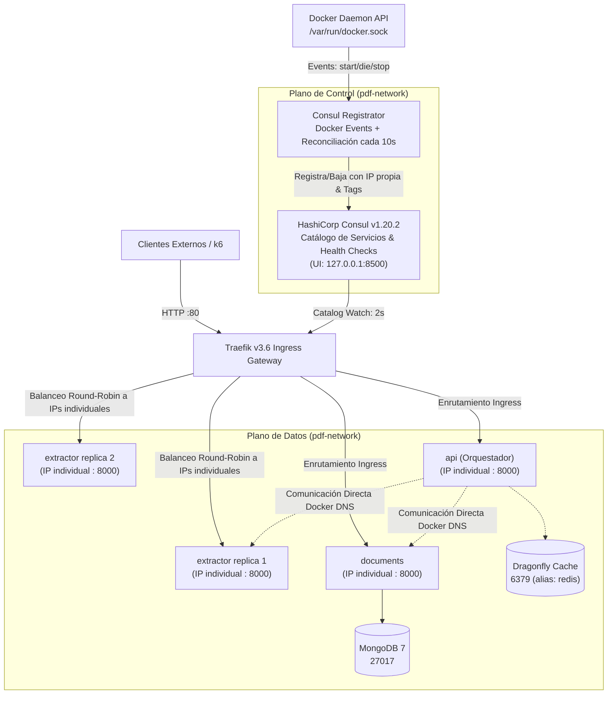

# PDF Infrastructure

Infraestructura compartida para la arquitectura de microservicios de procesamiento de PDFs (`pdf-extractext`).  
**Cátedra:** Desarrollo de Software — UTN Facultad Regional San Rafael.

Este repositorio centraliza y provee:
1. **Red Externa de Docker (`pdf-network`)**: Puente de comunicación compartido entre todos los microservicios, el reverse proxy y el catálogo.
2. **HashiCorp Consul (Catálogo y Registro Dinámico de Servicios)**: Servidor persistente (v1.20.2) con UI en `127.0.0.1:8500` y health checks HTTP individuales para cada réplica e IP.
3. **Consul Registrator**: Componente liviano que sincroniza el ciclo de vida de los contenedores Docker con Consul en tiempo real vía eventos del daemon y reconciliación periódica.
4. **Reverse Proxy, Ingress y Balanceador de Carga (Traefik v3.6)**: Integra el proveedor nativo `consulCatalog` para descubrir y balancear automáticamente microservicios a partir de sus instancias registradas en Consul.
5. **Separación Estricta de Proveedores (Sin Colisiones)**: Consul Catalog gobierna los microservicios; Docker Provider se reserva exclusivamente para el dashboard interno de Traefik.
6. **Patrones de Resiliencia en Ingress**: Implementación y coordinación de **Rate Limiting (HTTP 429)**, **Circuit Breaker (HTTP 503)** y **Retry (Reintentos)** mediante archivos dinámicos (`@file`).
7. **Caché Dragonfly (Perfil condicional `cache`)**: Reemplazo multi-threaded de alto rendimiento compatible con Redis (RESP) para optimización post-baseline.
8. **Factor IX de Twelve-Factor App (Desechabilidad)**: Inicio rápido (< 5s), apagado elegante (`SIGTERM`), drenado de peticiones en vuelo, y recuperación ante muerte súbita.
9. **Suite Oficial de Benchmarks (k6 Spike Test)**: Prueba de carga con 100 VUs sobre el dataset oficial de 279 páginas.

---

## Arquitectura del Ecosistema



---

## Convención de Hostnames, Puertos y UIs

| Componente | Dominio Local Traefik | Acceso Directo / Admin | Proveedor de Enrutamiento |
| :--- | :--- | :--- | :--- |
| **Traefik Dashboard** | `http://traefik.universidad.localhost` | `http://127.0.0.1:8080` (restringido a loopback) | `docker` (`api@internal`) |
| **Consul Web UI / API** | *No expuesto vía proxy público* | `http://127.0.0.1:8500` (restringido a loopback) | N/A (Plano de Control) |
| **API Orchestrator** | `http://api.universidad.localhost` | Vía Ingress HTTP 80 | `consulCatalog` (`api`) |
| **Document Service** | `http://documents.universidad.localhost` | Vía Ingress HTTP 80 | `consulCatalog` (`documents`) |
| **Extractor Service** | `http://extractor.universidad.localhost` | Vía Ingress HTTP 80 (Balanceado N réplicas) | `consulCatalog` (`extractor`) |
| **MongoDB 7** | *No expuesto públicamente* | Puerto interno `27017` | N/A |
| **Dragonfly** (Caché) | *No expuesto públicamente* | Puerto interno `6379` (alias `redis`) | N/A |

> [!NOTE]
> Cualquier subdominio de `*.localhost` resuelve automáticamente a `127.0.0.1` de forma nativa en la mayoría de los sistemas operativos modernos sin necesidad de modificar `/etc/hosts`.

---

## Integración de HashiCorp Consul

Consul opera como la **fuente única de verdad** para el descubrimiento de servicios dinámicos:
- **Instancias Individuales:** Cada réplica del Extractor se registra con un ID único (`extractor-<container_id>`) y su dirección IP asignada en `pdf-network` (ej. `172.28.0.7`).
- **Health Checks de Readiness en Consul:** Cada instancia cuenta con una sonda HTTP periódica apuntando a su endpoint de preparación (`http://<IP>:8000/health/ready` para Extractor/Documents, y `/ready` para API, cada 3s).
- **Filtrado Estricto en Traefik (`strictChecks: ["passing"]`):** Traefik v3.6 descarta automáticamente cualquier backend cuyo estado sea `warning` o `critical`, impidiendo que peticiones de clientes ingresen a réplicas en proceso de apagado o degradadas.
- **Sincronización en Tiempo Real (`consul-registrator`):** Escucha eventos de Docker (`start`, `die`, `stop`, `kill`) para altas y bajas inmediatas, complementado con reconciliación periódica cada 10 segundos ante inconsistencias de red.
- **Sin Duplicación de Routers:** Los microservicios tienen `traefik.enable=false` en sus etiquetas de Docker, evitando que Docker Provider cree routers duplicados. Consul Catalog es el único responsable del enrutamiento de los microservicios.

---

## Patrones de Resiliencia en Traefik v3.6

Los middlewares dinámicos residen en `traefik/dynamic/middlewares.yml` (proveedor `file`) y se vinculan a las instancias de Consul mediante tags:

```
[ Petición HTTP ] ──► [ 1. Rate Limiting ] ──► [ 2. Circuit Breaker ] ──► [ 3. Retry ] ──► [ Instancia Saludable ]
```

1. **Rate Limiting (`rate-limit-extract@file` / `rate-limit-api@file`):** Descarta ráfagas excesivas con `HTTP 429 Too Many Requests`. Los endpoints de salud (`/health`, `/ready`) tienen router prioritario (`priority=100`) **sin** limitador para no bloquear las comprobaciones de Consul o Docker.
2. **Circuit Breaker (`circuit-breaker-extractor@file`):** Interrumpe temporalmente el tráfico respondiendo `HTTP 503 Service Unavailable` si la tasa de fallos de red o errores 5xx supera el umbral ($\text{NetworkErrorRatio}() > 0.30 \lor \text{ResponseCodeRatio}(500, 600, 0, 600) > 0.25$).
3. **Retry (`retry-on-shutdown@file`):** Reintenta hasta 3 veces con 100ms iniciales **únicamente si el socket no responde** (falla transitoria). Si el microservicio devuelve cualquier código HTTP (200, 4xx, 5xx), Traefik **no** reintenta, garantizando que operaciones no idempotentes (`POST /extract`) no se dupliquen.
4. **Frontera de Ingress vs. Llamadas Internas:** Traefik protege exclusivamente el tráfico Ingress. Para las llamadas inter-servicio internas (`api` hacia `extractor:8000` o `documents:8000`), el API Orchestrator debe implementar en su cliente HTTP reintentos con backoff exponencial y jitter, y circuit breaker a nivel de cliente.

---

## Factor IX: Desechabilidad y Secuencia de Drenado Controlado

- **Arranque Rápido:** Contenedores pasan a `healthy` en menos de **5 segundos** (medido de forma aislada en la instancia nueva vía `docker inspect`).
- **Manejo de Señales Unix:** `init: true` (PID 1 con tini) y forma `exec` en `CMD` garantizan propagación limpia de `SIGTERM`.
- **Secuencia de Drenado Controlado:**
  1. Al recibir `SIGTERM`, el microservicio marca `shutting_down = True`.
  2. Su endpoint de readiness (`/health/ready` o `/ready`) devuelve inmediatamente `HTTP 503`.
  3. Consul marca la instancia como `critical`.
  4. Traefik, filtrando por `strictChecks: ["passing"]`, desaloja de inmediato la réplica del balanceo Ingress.
  5. El contenedor drena y finaliza las extracciones/solicitudes en curso dentro de la ventana de `stop_grace_period` (35s en extractor, 30s en documents/api).
  6. Finaliza limpiamente con **`ExitCode = 0`**.
- **Muerte Súbita (`SIGKILL`):** Si una instancia se destruye súbitamente (`ExitCode = 137`), Consul y Traefik descartan la réplica y el tráfico continúa sin interrupciones a través de las réplicas sobrevivientes.

---

## Puesta en Marcha Inicial

### 1. Variables de Entorno
Copiar la plantilla `.env.example` a `.env`:
```bash
cp .env.example .env     # Linux / macOS
copy .env.example .env   # Windows CMD
Copy-Item .env.example .env # Windows PowerShell
```

### 2. Inicializar la Red Externa (`pdf-network`)
```bash
# Linux / macOS
chmod +x init-network.sh && ./init-network.sh

# Windows
.\init-network.bat
```

### 3. Iniciar Traefik y Consul Base
```bash
docker compose up -d
```
- Traefik Dashboard: `http://127.0.0.1:8080`
- Consul Web UI: `http://127.0.0.1:8500`

---

## Integración del Ecosistema Completo

Para levantar todos los microservicios con registro dinámico en Consul:

```bash
docker compose -f docker-compose.integration.yml up -d --build
```

Para escalar el extractor a 5 réplicas:
```bash
docker compose -f docker-compose.integration.yml up -d --scale extractor=5
```
Consul Registrator detectará las 5 réplicas en tiempo real y Traefik actualizará automáticamente su pool de servidores balanceados en `http://extractor.universidad.localhost`.

---

## Scripts de Validación y Pruebas

### 1. Validación Automatizada de HashiCorp Consul
Verifica la salud de Consul, registro de instancias con IPs propias, escalado dinámico, baja de réplicas, recuperación y ausencia de routers duplicados:
```bash
# Linux / macOS
chmod +x scripts/test-consul.sh
./scripts/test-consul.sh

# Windows PowerShell
.\scripts\test-consul.ps1
```

### 2. Validación de Patrones de Resiliencia (Rate Limit, Circuit Breaker, Retry)
Verifica que las ráfagas reciban HTTP 429, que `/health` permanezca accesible y que los middlewares estén activos:
```bash
# Linux / macOS
chmod +x scripts/test-resilience-patterns.sh
./scripts/test-resilience-patterns.sh

# Windows PowerShell
.\scripts\test-resilience-patterns.ps1
```

### 3. Validación de Factor IX (Desechabilidad)
Mide el cold start (< 5s), lanza una extracción real de PDF mientras detiene una réplica y valida `ExitCode = 0`:
```bash
# Linux / macOS
chmod +x scripts/test-disposability.sh
./scripts/test-disposability.sh

# Con prueba de muerte súbita (SIGKILL / 137):
./scripts/test-disposability.sh --allow-destructive

# Windows PowerShell
.\scripts\test-disposability.ps1
.\scripts\test-disposability.ps1 -AllowDestructive
```

### 4. Benchmark de Carga Spike con k6 (100 VUs)
Ejecuta la prueba de concurrencia oficial sobre el endpoint `/extract`:
```bash
k6 run load-tests/k6-spike.js
```

---

## Consideraciones de Seguridad y Limitaciones
- **Servidor Único de Consul:** La configuración de desarrollo utiliza un único nodo (`-server -bootstrap-expect=1`). En producción, se debe desplegar un clúster de alta disponibilidad (HA) con 3 o 5 servidores Consul coordinados mediante quórum Raft.
- **Seguridad del Docker Socket:** `registrator` y `traefik` montan `/var/run/docker.sock:ro`. El flag `:ro` impide escribir sobre el archivo de socket, pero **no** restringe llamadas a la API de Docker. En producción, debe utilizarse un **Docker Socket Proxy** (`tecnativa/docker-socket-proxy`) bloqueando peticiones POST, DELETE y EXEC (`CONTAINERS=1`, `EVENTS=1`, `NETWORKS=1`).
- **Control de Acceso (Consul ACLs):** En producción, debe activarse el sistema de ACLs de Consul (`default_policy: "deny"`), aprovisionando tokens dedicados con mínimo privilegio: un token de escritura para `registrator` (`service:write`) y un token de solo lectura para `traefik` (`service:read`).
- **Restricción de Puertos Administrativos:** Los puertos `8080` (Traefik Dashboard) y `8500` (Consul API/UI) se encuentran estrictamente vinculados a `127.0.0.1`, impidiendo su exposición en redes públicas o interfaces externas.
- **Límites Operativos del Orquestador (`api`):** El servicio `api` está acotado en `536870912` bytes (512 MiB de RAM), `MAX_UPLOAD_BYTES: 20971520` (20 MiB) y `MAX_CONCURRENT_REQUESTS: 2` para evitar desbordes de memoria y activación de OOMKiller ante múltiples cargas simultáneas.
